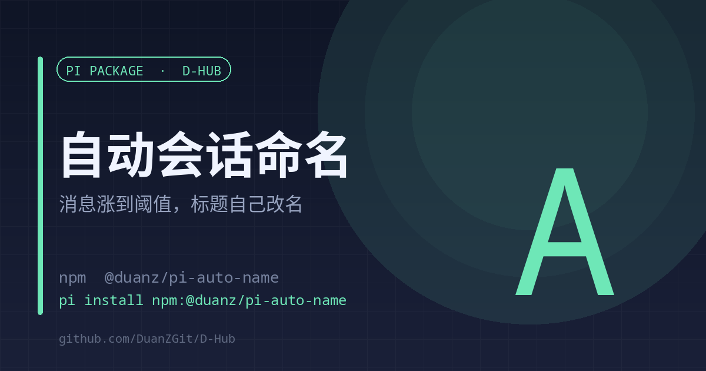

# auto-name

<strong>English</strong> | <a href="./README.md">中文</a>

<strong>Session titles rename themselves once a conversation grows</strong> Two-tier naming · instant title from the first message · refine every 20 entries

<code>pi install npm:@duanz/pi-auto-name</code>

## Why

A new session title is either empty or the first message cut off mid-sentence. Twenty sessions in the sidebar look identical, and you rename them by hand exactly once.

This extension grows titles on its own, in two tiers:

1. **Free naming** — when the agent starts and the session has no title, take the first 24 characters of the first user message. The sidebar and completion notifications become readable immediately.
2. **Model refinement** — after each completed turn, if at least 20 new session entries appeared since the last naming, call pi-web's `POST /api/sessions/:id/auto-name` to regenerate.

State the last naming per session, so it never calls a model every turn.

## Usage

Nothing to configure. Works inside pi-web after `/reload` or a restart.

In CLI mode there is no `PI_SESSION_ID`, so the extension skips itself silently.

## Configuration

| Variable | Default | Description |
| --- | --- | --- |
| `AUTO_NAME_STEP` | `20` | New entries required before a refinement |
| `AUTO_NAME_DEBOUNCE` | `300` | Minimum seconds between renames |
| `AUTO_NAME_QUICK_MAX` | `24` | Max characters for the instant title |
| `AUTO_NAME_OFF` | empty | Set to `1` to disable |
| `PI_WEB_PORT` | auto | Tries `30142`, then `30152` |

## State and logs

- `~/.pi/agent/auto-name-state.json` — entry count and last rename per session
- `~/.pi/agent/auto-name.log` — one line per rename with trigger and result

## Limits

- Requires pi-web's auto-name endpoint; no effect in pure CLI.
- Refinement costs tokens from the current model, hence the 20-entry / 300-second gates.

## License

MIT © DuanZ
