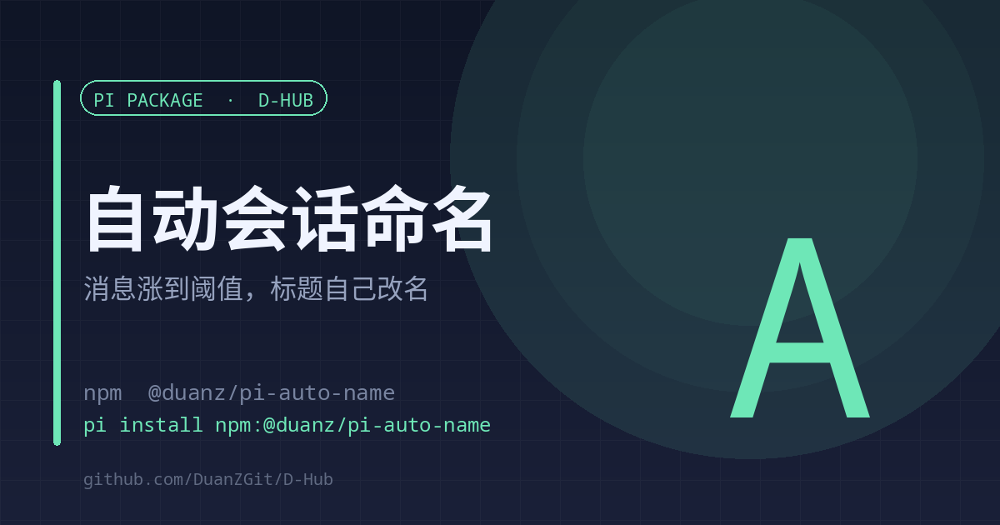

# auto-name

<a href="./README.en.md">English</a> | <strong>中文</strong>

<strong>会话聊到一定量，标题自己换成能看懂的那句</strong> 两层命名 · 首条消息秒命名 · 每 20 条会话条目精修一次

<code>pi install npm:@duanz/pi-auto-name</code>

## 它解决什么

新会话的标题要么是空的，要么是第一条消息硬截断的十几个字。侧栏里并排二十个会话，长得都一样，回头找的时候全靠运气。手动改名？改一次忘一次。

这个扩展让标题自己长出来，分两层：

1. **零成本起名**：agent 刚启动、会话还没有名字时，直接把第一条用户消息的前 24 个字设成标题。侧栏和完成通知立刻可辨识。
2. **模型精修**：每轮彻底跑完后检查一次，距上次命名新增 ≥ 20 条会话条目，就调 pi-web 的 `POST /api/sessions/:id/auto-name` 重新生成一次标题。

两层之间用状态文件隔开，不会每轮都去调模型。

## 用法

装完无需配置，在 pi-web 里自动生效：`/reload` 或重启一次即可。

CLI 模式下没有 `PI_SESSION_ID`，扩展自己跳过，不会报错。

## 配置

| 变量 | 默认 | 说明 |
| --- | --- | --- |
| `AUTO_NAME_STEP` | `20` | 新增多少条会话条目触发一次精修 |
| `AUTO_NAME_DEBOUNCE` | `300` | 两次命名的最小间隔（秒） |
| `AUTO_NAME_QUICK_MAX` | `24` | 首层截断的最大字数 |
| `AUTO_NAME_OFF` | 空 | 设为 `1` 临时关闭 |
| `PI_WEB_PORT` | 自动探测 | 先试 `30142`，再试 `30152` |

## 状态与日志

- `~/.pi/agent/auto-name-state.json`：按 sessionId 记录条目数与上次命名时间
- `~/.pi/agent/auto-name.log`：每次命名的时间、触发原因、结果

## 限制

- 需要 pi-web 的 auto-name 接口，纯 CLI 环境不生效。
- 精修会消耗当前模型的 token，所以有 20 条 + 300 秒双阈值挡着。

## License

MIT © DuanZ
