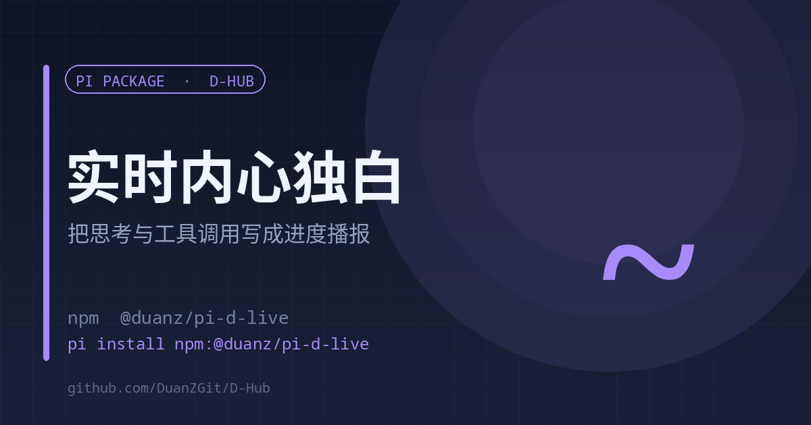

# d-live

<p align="center"><strong>English</strong> | <a href="./README.md">中文</a></p>

<p align="center"></p>

<p align="center"><strong>Turns the model's thinking and tool calls into a live progress strip in pi-web</strong><br><sub>Local SSE · sentence-level batching · per-session isolation</sub></p>

<p align="center">
<a href="https://www.npmjs.com/package/@duanz/pi-d-live"></a>
<a href="https://github.com/DuanZGit/D-Hub/blob/master/LICENSE"></a>
<a href="https://github.com/DuanZGit/D-Hub"></a>

</p>

<p align="center">
<code>pi install npm:@duanz/pi-d-live</code>
</p>

## Why

During a long task the screen shows a spinner and a list of English tool names. The user waits without knowing where the work is going.

d-live takes agent events (`thinking_delta`, `tool_execution_start`), batches them at sentence boundaries, rewrites them with **the current session model** into 3–6 plain sentences, and pushes them to a floating strip at the top of pi-web.

## Data flow

```
pi agent events → sentence batching → ctx.modelRegistry.complete() rewrite → local SSE (127.0.0.1:18999/live) → front-end strip
```

- Batching: at least 70 characters before a sentence break, hard cap 300; queue cap of 4 segments drops new ones to stay live
- Rewrite: 12-second hard timeout; no file names, function names, ports, or paths
- Isolation: every push carries a `sid`; the front end plays only the current session
- Tool names use a zero-latency label map (`read` → "take a look"), no model call

## Usage

```
/d-live on        # enable (/live is an alias)
/d-live off       # disable
/d-live status    # current state
```

Local endpoints: `GET /live` (SSE), `GET /health`, `GET /ping`.

## Prerequisite

The strip is front-end code and needs a pi-web injection: `cn-assets/pi-web-live.js` is inlined into `public/sw.js` through `patches.json`, replayed after pi-web upgrades by [pi-web-patch-keeper](https://github.com/DuanZGit/D-Hub/tree/master/extensions/pi-web-patch-keeper).

Without that injection the SSE server still runs; nothing shows in the page.

## Limits

- Each rewrite costs tokens from the current model (about 2 seconds per segment); `/d-live off` on token-heavy sessions.
- pi-web only — pure CLI has no injection point.

## License

MIT © DuanZ
