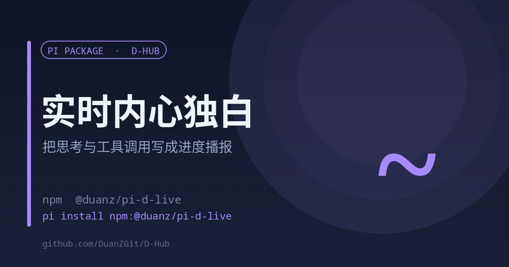

# d-live

<p align="center"><a href="./README.en.md">English</a> | <strong>中文</strong></p>

<p align="center"></p>

<p align="center"><strong>把模型的思考和工具调用，实时改写成页面顶部的进度播报</strong><br><sub>本地 SSE · 按句切段 · 多会话隔离 · 不占终端</sub></p>

<p align="center">
<a href="https://www.npmjs.com/package/@duanz/pi-d-live"></a>
<a href="https://github.com/DuanZGit/D-Hub/blob/master/LICENSE"></a>
<a href="https://github.com/DuanZGit/D-Hub"></a>

</p>

<p align="center">
<code>pi install npm:@duanz/pi-d-live</code>
</p>

## 它解决什么

长任务里，屏幕上只有一个转圈的 spinner 和一串英文工具名。用户在等，却不知道这件事推进到哪了、下一步往哪走。

d-live 把 agent 事件（`thinking_delta`、`tool_execution_start`）按句切段，用**当前会话的模型**改写成 3–6 句日常话，推到 pi-web 页面顶部的浮层条里播。

## 数据流

```
pi agent 事件 → 按句切段 → ctx.modelRegistry.complete() 改写 → 本地 SSE(127.0.0.1:18999/live) → 前端浮层
```

- 切段：至少 70 字才允许按句号切，硬上限 300 字；队列上限 4 段，超了丢新段，保证实时性
- 改写：单次硬超时 12 秒；不写文件名、函数名、端口、路径
- 隔离：每条推送带 `sid`，前端只播当前会话的
- 工具行先用零延迟规则占位（`read` → 「看一眼」），随后由模型改写成「在哪找什么、为了什么」，慢一点但更具体
- emoji 不强制、不固定：模型按内容自己决定放哪、放几个，前端不补也不挪位置

## 用法

```
/d-live on        # 开启（/live 是兼容别名）
/d-live off       # 关闭
/d-live status    # 看当前状态
```

本地端点：`GET /live`（SSE）、`GET /health`、`GET /ping`。

## 前置条件

浮层是前端代码，需要 pi-web 侧注入：`cn-assets/d-live.js` 由 `patches.json` 以 inline 方式注进 `public/sw.js`，由 [pi-web-patch-keeper](https://github.com/DuanZGit/D-Hub/tree/master/extensions/pi-web-patch-keeper) 在 pi-web 升级后重放。

没有这层注入时，扩展的 SSE 服务照常工作，只是页面上看不到浮层。

## 限制

- 每段改写都消耗当前模型 token（实测每段约 2 秒），任务极多时可 `/d-live off`。
- 只面向 pi-web；纯 CLI 没有注入点。

## License

MIT © DuanZ
