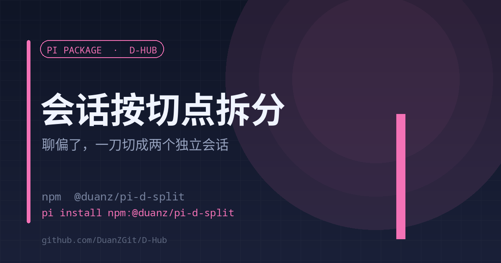

# d-split

<strong>English</strong> | <a href="./README.md">中文</a>

<strong>Split a drifted conversation into two independent sessions at a cut point</strong> The original session stays byte-for-byte intact

<code>pi install npm:@duanz/pi-d-split</code>

## Why

A session runs long and drifts to a new topic. Continuing mixes both contexts; starting fresh loses the earlier thread.

d-split cuts a session into two independent `.jsonl` files at a cut point: everything up to the cut becomes session A, everything after becomes session B. **The original file is untouched**, and both new sessions can continue.

## Why it writes files itself

A session is a tree. `fork_branch` can only produce "root → some path"; it cannot extract "everything after a cut point". So this extension rebuilds both halves along the `parentId` chain:

- A = root .. cut point
- B = after cut point .. leaf, with the first entry's `parentId` pointing at an injected `custom_message` ("this segment was split off — do not redo completed work")

## Usage

The model calls the `d_split` tool:

| Parameter | Meaning |
| --- | --- |
| no `cutAt` | Return only the timeline (index / entryId / role / summary) so a cut point can be chosen |
| `cutAt` | entryId, or the Nth user message (1-based) |
| `nameA` / `nameB` | Titles for both sessions |
| `noteB` | Note prepended to B; auto-generated when omitted |
| `wake` | `both` (default) / `b` / `none` — whether to start them right away |

Typical flow: run once without `cutAt`, offer 2–3 candidate cut points, then split.

## Configuration

| Variable | Default | Description |
| --- | --- | --- |
| `D_SPLIT_OFF` | empty | Set to `1` to disable |
| `PI_WEB_PORT` | auto | `30142` → `30152` |
| `SPLIT_TIMELINE_MAX` | `200` | Max timeline entries returned |

Log: `~/.pi/agent/d-split.log`

## Limits

- Works on the current branch only; other branches are not copied.
- After splitting, the original session is still listed (not deleted).

## License

MIT © DuanZ
