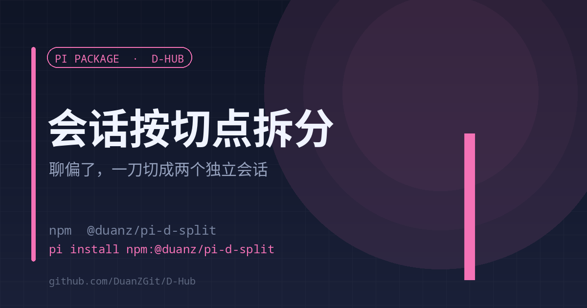

# d-split

<a href="./README.en.md">English</a> | <strong>中文</strong>

<strong>聊偏了，按一条消息把会话切成两个独立会话</strong> 原会话一个字节不动 · 不给切点先给时间轴

<code>pi install npm:@duanz/pi-d-split</code>

## 它解决什么

一个会话聊了很久，中途开了个新话题。继续聊下去两边互相污染上下文；从头开新会话，之前那段又带不走。

d-split 按切点把会话拆成两个独立的 `.jsonl`：切点及之前是 A 段，切点之后是 B 段。**原会话文件保持原样**，两个新会话各自可以继续。

## 为什么自己写文件

会话是一棵树。`fork_branch` 只能切出「根 → 某条路径」，切不出「切点之后」那一段。所以这里按 `parentId` 链自己拼两段：

- A 段 = 根 .. 切点
- B 段 = 切点之后 .. leaf，首条的 `parentId` 改指向一条注入的 `custom_message`（说明「本段由拆分而来，已完成的部分不要重做」）

## 用法

模型调用 `d_split` 工具：

| 参数 | 说明 |
| --- | --- |
| 不传 `cutAt` | 只返回时间轴（序号 / entryId / 角色 / 摘要），用来挑切点 |
| `cutAt` | entryId，或第 N 条用户消息（1 起） |
| `nameA` / `nameB` | 两侧会话标题 |
| `noteB` | 插到 B 开头的说明，省略则自动生成 |
| `wake` | `both`（默认）/ `b` / `none`，拆完要不要自动起跑 |

典型流程：先不带 `cutAt` 跑一次，拿到时间轴后挑 2–3 个候选切点给用户确认，再真拆。

## 配置

| 变量 | 默认 | 说明 |
| --- | --- | --- |
| `D_SPLIT_OFF` | 空 | 设为 `1` 关闭 |
| `PI_WEB_PORT` | 自动探测 | `30142` → `30152` |
| `SPLIT_TIMELINE_MAX` | `200` | 时间轴最多返回多少条 |

日志：`~/.pi/agent/d-split.log`

## 限制

- 只处理当前分支，不复制其他分支。
- 拆分后 A/B 是两个新文件，原会话仍在列表里（不删）。

## License

MIT © DuanZ
