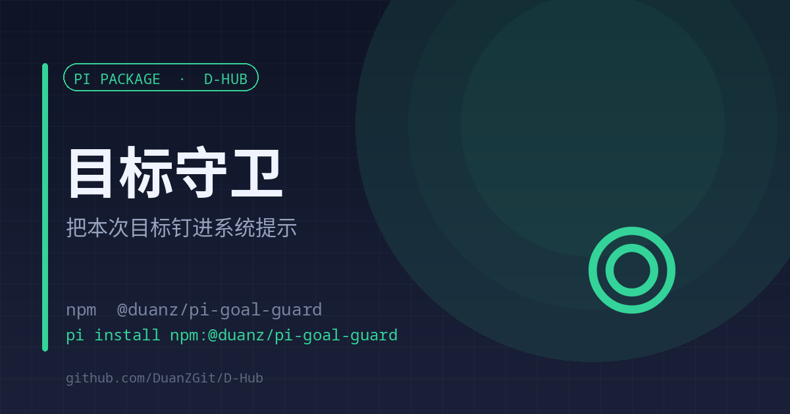

# goal-guard

<p align="center"><strong>English</strong> | <a href="./README.md">中文</a></p>

<p align="center"></p>

<p align="center"><strong>Pins the goal of this session into every system prompt</strong><br><sub>One line of goal · two rules · a few dozen tokens</sub></p>

<p align="center">
<a href="https://www.npmjs.com/package/@duanz/pi-goal-guard"></a>
<a href="https://github.com/DuanZGit/D-Hub/blob/master/LICENSE"></a>
<a href="https://github.com/DuanZGit/D-Hub"></a>

</p>

<p align="center">
<code>pi install npm:@duanz/pi-goal-guard</code>
</p>

## Why

The main failure of a long session is that the goal evaporates. The user asks for a small fix, the assistant dives in, and the original objective is silently gone with nobody noticing.

Putting it in `AGENTS.md` is not enough: that text gets diluted in a long context, and it only says "remember to revisit the goal" — an abstraction.

goal-guard pins **what this session must achieve** into the system prompt of every turn. One line of goal plus two rules, a few dozen tokens, seen every turn.

## Usage

```
/goal Migrate the login flow to email codes   # set (rest of the line is the goal)
/goal                                        # show current goal
/goal clear                                  # clear
```

For automation, seed it from the environment:

```bash
GOAL="Make d-reach quota counting daily" pi
```

## How

```ts
pi.on("before_agent_start", (event) => goal ? {
  systemPrompt: `${event.systemPrompt}\n\n## Session goal\n${goal}\n\n${RULE}`,
} : undefined);
```

The two injected rules:

1. If a new request drifts from the goal, confirm in one sentence before acting ("this diverges from X: do it now, or record it as a todo?")
2. After each chunk of work, look back at the goal and state what is still missing

## Limits

- The goal lives in a process variable; after a pi restart you must set it again unless you use `GOAL`.
- It makes the goal visible every turn; it does not judge whether the goal is met.

## License

MIT © DuanZ
