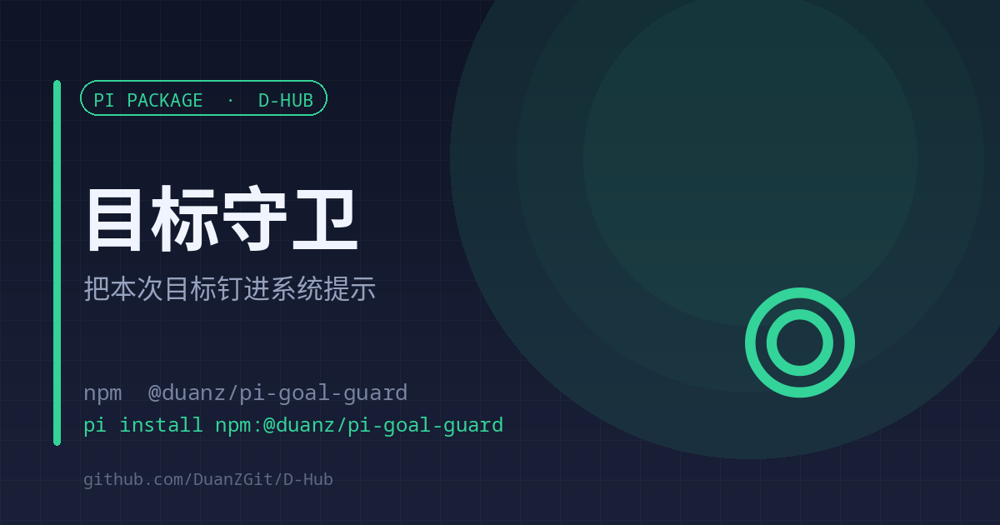

# goal-guard

<p align="center"><a href="./README.en.md">English</a> | <strong>中文</strong></p>

<p align="center"></p>

<p align="center"><strong>把本次要达成的事钉进系统提示，长会话不跑偏</strong><br><sub>一行目标 · 两条守则 · 只占几十个 token</sub></p>

<p align="center">
<a href="https://www.npmjs.com/package/@duanz/pi-goal-guard"></a>
<a href="https://github.com/DuanZGit/D-Hub/blob/master/LICENSE"></a>
<a href="https://github.com/DuanZGit/D-Hub"></a>

</p>

<p align="center">
<code>pi install npm:@duanz/pi-goal-guard</code>
</p>

## 它解决什么

长会话最大的问题是目标自己蒸发。用户因为一个小问题提了个修改，助手埋头做完，原始目标就没了，全程没人提醒。

写进 `AGENTS.md` 也不够：那段文字在长上下文里会被稀释，而且它说的是「记得回顾目标」这种抽象要求。

goal-guard 把**这一次要达成什么**钉进每一轮的系统提示。目标只有一行，加上两条守则，总共几十个 token，换来的是每轮都被看见。

## 用法

```
/goal 把登录流程改成邮箱验证码       # 设置（后面的话就是目标）
/goal                                # 查看当前目标
/goal clear                          # 清除（也接受「清除」）
```

自动化场景可以用环境变量给初始值：

```bash
GOAL="把 d-reach 的额度计数改成按天" pi
```

## 原理

```ts
pi.on("before_agent_start", (event) => goal ? {
  systemPrompt: `${event.systemPrompt}\n\n## 本会话目标\n${goal}\n\n${RULE}`,
} : undefined);
```

注入的守则两条：

1. 新请求若偏离目标，先用一句话确认再动手（「这偏离了 X：插队做，还是先记成待办？」）
2. 每完成一段工作，回头看一眼目标，说清「离目标还差什么」

## 限制

- 目标保存在扩展的进程内变量里，pi 重启后需要重新 `/goal`；想持久化就用 `GOAL` 环境变量。
- 它只负责「让目标每轮可见」，不负责判定目标是否完成。

## License

MIT © DuanZ
