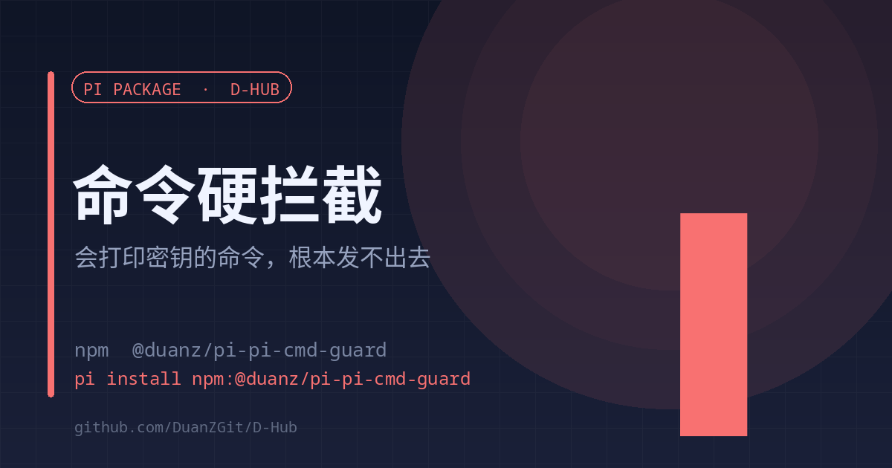

# pi-cmd-guard

<strong>English</strong> | <a href="./README.md">中文</a>

<strong>Commands that would print plaintext secrets never run</strong> Blocked at tool_call · with an alternative that works

<code>pi install npm:@duanz/pi-pi-cmd-guard</code>

## Why

The incident: one `sudo systemctl cat caddy` printed the unit's `Environment=ALI_ACCESS_KEY_SECRET=...` line straight into context. The command succeeded, and the secret went into the transcript.

Masking afterwards is pointless — the value already left. This blocks **before execution**.

## Rules

| Rule | Why it is dangerous | Instead |
| --- | --- | --- |
| `systemctl restart/stop/kill pi-web` | Kills other running sessions and in-flight turns | `d_restart` tool or `d-restart` |
| `systemctl cat` | Prints `Environment=` with plaintext values | `systemctl show <unit> -p EnvironmentFiles,ExecStart,User` |
| `systemctl show ... Environment` | Dumps variable values | `systemctl show <unit> -p EnvironmentFiles` |
| bare `env` / `printenv` | Dumps the whole process environment | Ask for one variable by name |
| `printenv <secret>` | Prints that value | Inspect existence / length / hash |
| `cat <secret file>` | The file *is* the secret | Check permissions and hash |
| Reading `/proc/*/environ` | Raw process environment bytes | Same as above |
| `grep` over the environment | Matching lines carry the values | Filter by allowlisted field names |

## Usage

Enabled on install, nothing to configure.

- Disable: `PI_CMD_GUARD=off`
- Commands the user types (`!` prefix) bypass this hook and still work

## How

A `tool_call` hook matches bash commands and returns `{ block: true, reason, alternative }`, so the command never runs. `RULES` is one regex + one reason + one alternative per entry — adding a rule is one object.

## Limits

- Covers the `bash` tool only; user `!` commands and external scripts are out of scope.
- Patterns are regexes; deliberate obfuscation can slip through. This is anti-accident, not anti-attacker.

## License

MIT © DuanZ
