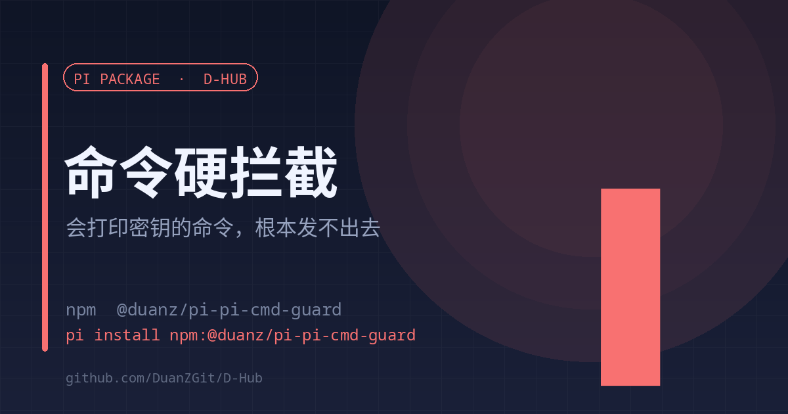

# pi-cmd-guard

<a href="./README.en.md">English</a> | <strong>中文</strong>

<strong>会打印明文密钥的命令，根本发不出去</strong> tool_call 阶段拦截 · 命令不执行 · 给替代写法

<code>pi install npm:@duanz/pi-pi-cmd-guard</code>

## 它解决什么

2026-11-05 的事故：一次 `sudo systemctl cat caddy` 把 unit 里的 `Environment=ALI_ACCESS_KEY_SECRET=...` 整行打进了上下文。命令成功执行，密钥随后进了对话记录。

事后遮蔽没有意义——值已经发出去了。所以要拦在**执行之前**。

## 拦截清单

| 规则 | 为什么危险 | 替代写法 |
| --- | --- | --- |
| `systemctl restart/stop/kill pi-web` | 掐断其他正在跑的会话，in-flight 轮次全丢 | `d_restart` 工具或 `d-restart` 命令 |
| `systemctl cat` | unit 里的 `Environment=` 整行带明文 | `systemctl show <unit> -p EnvironmentFiles,ExecStart,User` |
| `systemctl show ... Environment` | 直接 dump 变量值 | `systemctl show <unit> -p EnvironmentFiles` |
| 裸 `env` / `printenv` | dump 当前进程全部环境变量 | 只查确定的变量名 |
| `printenv <敏感名>` | 打印该变量明文 | 用 `safe_inspect` 类工具看存在/长度/哈希 |
| `cat <密钥文件>` | 文件内容就是明文密钥 | 看权限与哈希，不看值 |
| 读 `/proc/*/environ` | 进程环境块原始字节 | 同上 |
| `grep` 全环境 | 命中行把值一起打出来 | 按字段名白名单过滤 |

## 用法

装完即生效，无需配置。

- 关闭：`PI_CMD_GUARD=off`
- 用户自己敲的命令（`!` 开头）不经过这里，仍然可以执行

## 实现

在 `tool_call` 钩子里匹配 bash 命令，返回 `{ block: true, reason, alternative }`，命令根本不会执行。规则表 `RULES` 是一条正则 + 一句原因 + 一个替代写法，加新规则只加一条。

## 限制

- 只覆盖 `bash` 工具；其他执行路径（用户 `!` 命令、外部脚本）不在范围内。
- 规则是正则，刻意的变形写法可能绕过——这是防误触，不是防攻击。

## License

MIT © DuanZ
