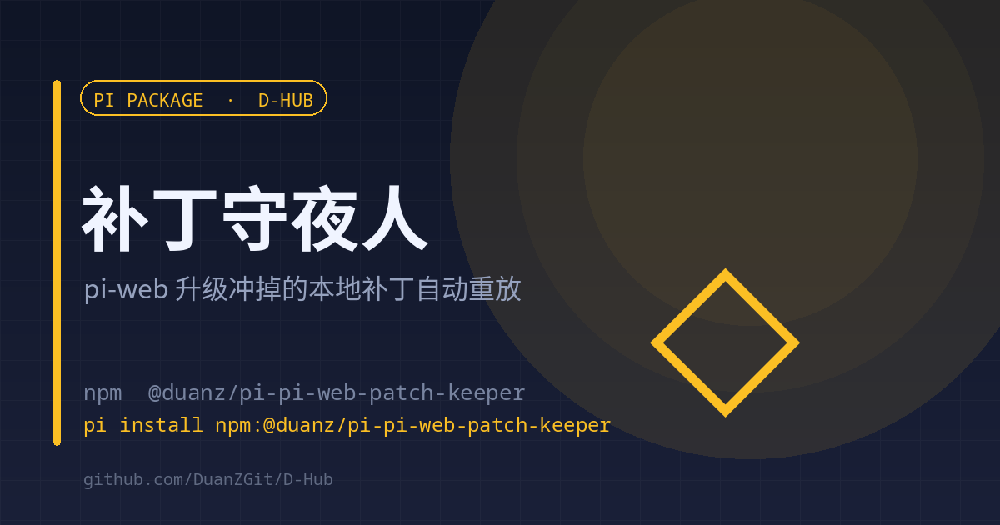

# pi-web-patch-keeper

<p align="center"><strong>English</strong> | <a href="./README.md">中文</a></p>

<p align="center"></p>

<p align="center"><strong>Local pi-web patches survive upgrades by replaying themselves on load</strong><br><sub>Checked on load · idempotent · rewrites only what the upgrade wiped</sub></p>

<p align="center">
<a href="https://www.npmjs.com/package/@duanz/pi-pi-web-patch-keeper"></a>
<a href="https://github.com/DuanZGit/D-Hub/blob/master/LICENSE"></a>
<a href="https://github.com/DuanZGit/D-Hub"></a>

</p>

<p align="center">
<code>pi install npm:@duanz/pi-pi-web-patch-keeper</code>
</p>

## Why

Local pi-web changes (project and session names in completion notifications, UI copy) can only live in build artifacts: `.next/server/chunks`, `.next/static`, `public/sw.js`. An `npm update` or reinstall replaces those files wholesale, the patches vanish, and nothing warns you.

## What it does

One thing: run `apply.py` when the extension loads.

- All changes are registered in `~/.pi/agent/.cn-patches/patches.json`
- `apply.py` replays them and is **idempotent**: applied patches are skipped; only ones wiped by an upgrade are written back
- When a replay happens, the next `agent_start` reminds you to restart pi-web

## Usage

1. Create the patch directory:

```
~/.pi/agent/.cn-patches/
├── patches.json     # patch registry
└── apply.py         # replay script
```

2. Install the extension and restart pi-web.

The extension does not know how patches are written — only when to run them.

## Configuration

| Variable | Default | Description |
| --- | --- | --- |
| `PI_WEB_PATCH_OFF` | empty | Set to `1` to disable |
| `PI_WEB_PATCH_INTERVAL_H` | `6` | Minimum hours between checks |

## State and logs

- `~/.pi/agent/.cn-patches/keeper-state.json` — last check time
- `~/.pi/agent/.cn-patches/keeper.log` — each run and what it replayed

## Limits

- You supply `patches.json` and `apply.py`; this is the shell, not the patches.
- A replay still needs a pi-web restart to take effect (the extension only reminds).

## License

MIT © DuanZ
