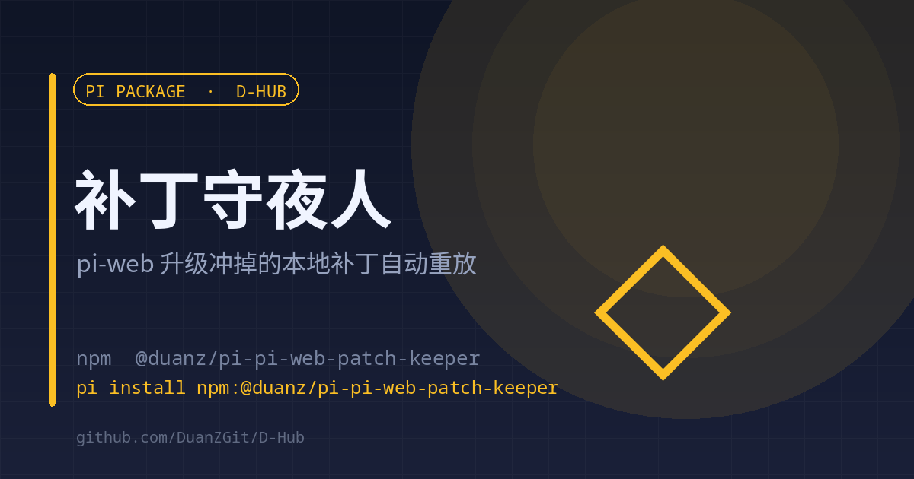

# pi-web-patch-keeper

<p align="center"><a href="./README.en.md">English</a> | <strong>中文</strong></p>

<p align="center"></p>

<p align="center"><strong>pi-web 升级会整包覆盖，本地补丁在下次加载时自动重放</strong><br><sub>加载即检查 · 幂等 · 被冲掉才写回</sub></p>

<p align="center">
<a href="https://www.npmjs.com/package/@duanz/pi-pi-web-patch-keeper"></a>
<a href="https://github.com/DuanZGit/D-Hub/blob/master/LICENSE"></a>
<a href="https://github.com/DuanZGit/D-Hub"></a>

</p>

<p align="center">
<code>pi install npm:@duanz/pi-pi-web-patch-keeper</code>
</p>

## 它解决什么

pi-web 的本地改动（完成通知显示项目名与会话名、界面文案等）只能改在编译产物里：`.next/server/chunks`、`.next/static`、`public/sw.js`。`npm update` 或重新安装会把这些文件整包覆盖，补丁全丢，而且没人提醒。

## 它做什么

只做一件事：扩展加载时跑一次 `apply.py`。

- 所有改动登记在 `~/.pi/agent/.cn-patches/patches.json`
- `apply.py` 负责重放，**幂等**：已应用的跳过，只有被升级冲掉的才写回
- 有重放发生时，在下一次 `agent_start` 提醒你重启 pi-web

## 用法

1. 建立补丁目录：

```
~/.pi/agent/.cn-patches/
├── patches.json     # 补丁登记表
└── apply.py         # 重放脚本
```

2. 装扩展，重启 pi-web。

扩展本身不判断补丁怎么写，只决定**什么时候跑**。

## 配置

| 变量 | 默认 | 说明 |
| --- | --- | --- |
| `PI_WEB_PATCH_OFF` | 空 | 设为 `1` 关闭 |
| `PI_WEB_PATCH_INTERVAL_H` | `6` | 两次检查的最小间隔（小时） |

## 状态与日志

- `~/.pi/agent/.cn-patches/keeper-state.json`：上次检查时间
- `~/.pi/agent/.cn-patches/keeper.log`：每次运行、重放了哪些补丁

## 限制

- 需要你自己准备 `patches.json` 与 `apply.py`；这是通用外壳，不含具体补丁内容。
- 有重放后仍需重启 pi-web 才生效（扩展只提醒，不重启）。

## License

MIT © DuanZ
