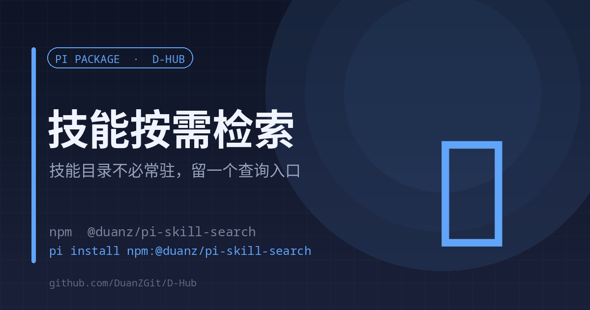

# skill-search

<strong>English</strong> | <a href="./README.md">中文</a>

<strong>Skill catalogs do not need to sit in the system prompt — one lookup tool is enough</strong> On-demand retrieval · paths only · no auto-injection

<code>pi install npm:@duanz/pi-skill-search</code>

## Why

pi keeps the skill catalog in the system prompt. On this machine 82 skills take about 21,164 characters (≈6,500 tokens) **every turn**, whether or not any of them is used.

Both off-the-shelf answers fall short:

1. Marking low-frequency skills `disable-model-invocation` saves tokens but makes them **invisible** to the model unless the user remembers `/skill:name`
2. Injecting the full index each turn spends the savings right back

This extension fills the gap: the catalog does not need to be resident, only the **lookup entry** does. One tool schema is about 120 tokens per turn.

## Usage

The model calls `skill_search`:

| Parameter | Meaning |
| --- | --- |
| `query` | Task description or keywords; omit to list every skill name |
| `limit` | Results to return, default 8 |

Returns `name` / `description` / absolute SKILL.md path. The model reads the body with `read` before deciding, so `path` is mandatory.

## Three design constraints

1. **Paths, not bodies.** SkillRouter measured on 80K candidates: exposing only name + description drops routing accuracy by 37–44 points. Retrieval must be body-aware.
2. **No auto-injection.** Stuffing a hint into `before_agent_start` spends the savings again; a tool in the list is enough.
3. **No frontmatter edits.** The extension lives in the extensions directory, so `uipro update` / `npx impeccable update` never clobber it.

## Configuration

| Variable | Default | Description |
| --- | --- | --- |
| `PI_AGENT_DIR` | `~/.pi/agent` | Skill root |
| `DESC_MAX` | `200` | Description truncation length |

## Relation to ask-me

`ask-me` is the human entry point (`/skill:ask-me`); `skill_search` is the model's. With this extension installed, the `ask-me` scan script becomes a fallback for environments without it (Minis, DSH).

## License

MIT © DuanZ
