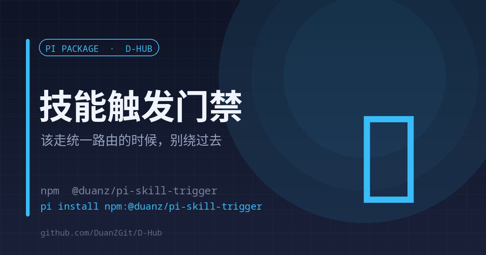

# skill-trigger

<p align="center"><strong>English</strong> | <a href="./README.md">中文</a></p>

<p align="center"></p>

<p align="center"><strong>When a task should route through one skill, do not let the model bypass it</strong><br><sub>Soft trigger injection · hard gate on built-in tools · escape hatch kept</sub></p>

<p align="center">
<a href="https://www.npmjs.com/package/@duanz/pi-skill-trigger"></a>
<a href="https://github.com/DuanZGit/D-Hub/blob/master/LICENSE"></a>
<a href="https://github.com/DuanZGit/D-Hub"></a>

</p>

<p align="center">
<code>pi install npm:@duanz/pi-skill-trigger</code>
</p>

## Why

pi skills are progressively disclosed: the system prompt carries only name + description, and the model decides whether to `read` the body. The docs say it plainly: "models don't always do this; use prompting or /skill:name to force it".

A real miss: the user said "go look this up across the web", and the assistant called the built-in `web_search` / `fetch_content` instead of the unified search router. Quota accounting drifted, no free channels were used, and there was no follow-up verification round.

## Two layers

**Layer 1 — soft injection**: `before_agent_start` matches trigger phrases and injects an invisible reminder for this turn ("this task should go through d-reach; read its SKILL.md first").

**Layer 2 — hard gate**: `tool_call` blocks the built-in `web_search` / `fetch_content` until the matching SKILL.md has been read in this session, and names the file to read.

## Layer 2 is deliberately narrow

1. **Only those two built-in tools; bash untouched.** Daily `curl` runs through bash, and gating it would need an error-prone domain allowlist.
2. **Local resources pass**: input without `http(s)://` is allowed (`file://`, local images and videos).
3. **Escape hatch**: any input field containing `#d-reach:allow` passes (explain to the user first); or `PI_SKILL_TRIGGER_GATE=off` disables the layer.

## Adding a skill

Add one entry to `RULES`; both layers read the same table:

```ts
{
  name: "d-reach",
  path: "/home/you/.pi/agent/skills/d-reach/SKILL.md",
  patterns: /search|look up|find out/i,
  hint: "This task needs the web: read d-reach's SKILL.md first.",
}
```

## Limits

- Patterns are regexes; rewording can miss. It is a safety net, not a guarantee.
- The hard gate covers built-in tools only. If the model uses `curl` in bash, this extension stays out of the way (intentionally).

## License

MIT © DuanZ
