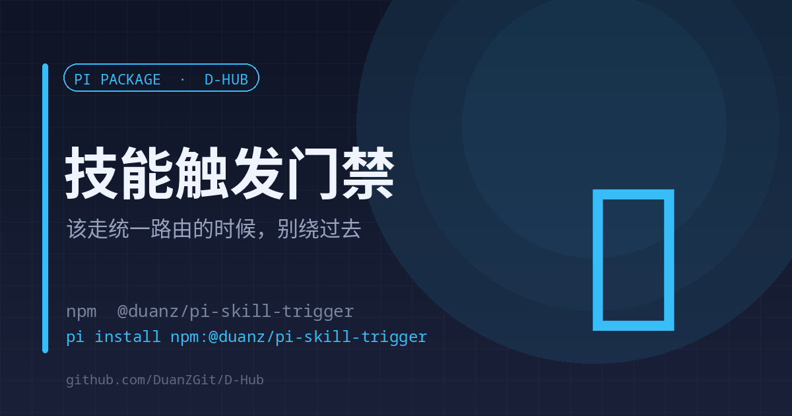

# skill-trigger

<p align="center"><a href="./README.en.md">English</a> | <strong>中文</strong></p>

<p align="center"></p>

<p align="center"><strong>该走统一路由的时候，别让模型绕过去</strong><br><sub>触发词软注入 · 内置工具硬门禁 · 逃生舱保留</sub></p>

<p align="center">
<a href="https://www.npmjs.com/package/@duanz/pi-skill-trigger"></a>
<a href="https://github.com/DuanZGit/D-Hub/blob/master/LICENSE"></a>
<a href="https://github.com/DuanZGit/D-Hub"></a>

</p>

<p align="center">
<code>pi install npm:@duanz/pi-skill-trigger</code>
</p>

## 它解决什么

pi 的技能是渐进披露：系统提示里只有 name + description，正文要模型自己决定去 `read`。官方文档原话是 "models don't always do this; use prompting or /skill:name to force it"。

2026-09-25 实测漏过一次：用户说「你去全网看一下」，助手直接调了内置 `web_search` / `fetch_content`，没走 d-reach。后果是额度记账失真、免费通道一个没用、只跑了一轮没有追证轮。

## 两层防线

**层 1 — 软注入**：`before_agent_start` 里检测触发词，命中就往本轮注入一条不显示的提醒（「这个任务该走 d-reach，先读 SKILL.md」）。

**层 2 — 硬门禁**：`tool_call` 里拦住内置 `web_search` / `fetch_content`。本会话没读过对应 SKILL.md 就不放行，并给出该读哪个文件。

## 层 2 刻意做窄

1. **只拦这两个内置工具，不碰 bash**。日常 `curl` 全走 bash，拦它需要域名白名单那种易错设计。
2. **本地资源不拦**：输入里没有 `http(s)://` 就放行（`file://`、本地图片/视频）。
3. **逃生舱**：任一输入字段带 `#d-reach:allow` 即放行（需先向用户说明理由）；或 `PI_SKILL_TRIGGER_GATE=off` 整层关掉。

## 扩展新技能

往 `RULES` 加一条即可，软注入与硬门禁共用同一张表：

```ts
{
  name: "d-reach",
  path: "/home/you/.pi/agent/skills/d-reach/SKILL.md",
  patterns: /搜一下|全网|search|看看有没有/i,
  hint: "这次要联网查东西，先读 d-reach 的 SKILL.md 再做。",
}
```

## 限制

- 规则是正则，措辞变化可能漏命中——它是兜底，不是保险。
- 硬门禁只对内置工具生效；模型如果改用 bash 里的 `curl`，本扩展不会拦（这是有意的）。

## License

MIT © DuanZ
