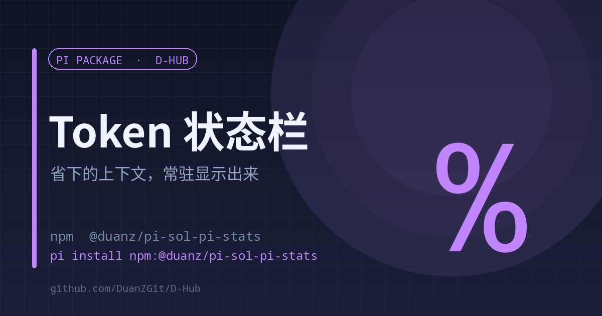

# sol-pi-stats

<p align="center"><strong>English</strong> | <a href="./README.md">中文</a></p>

<p align="center"></p>

<p align="center"><strong>Context saved by observation-pack, always visible in the status bar</strong><br><sub>Event-driven · no timers · silent on failure</sub></p>

<p align="center">
<a href="https://www.npmjs.com/package/@duanz/pi-sol-pi-stats"></a>
<a href="https://github.com/DuanZGit/D-Hub/blob/master/LICENSE"></a>
<a href="https://github.com/DuanZGit/D-Hub"></a>

</p>

<p align="center">
<code>pi install npm:@duanz/pi-sol-pi-stats</code>
</p>

## Why

sol-pi's observation-pack folds large tool outputs into placeholders and saves a lot of context. But it only flashes for 4 seconds when it saves something, then clears the status — the cumulative amount is invisible afterwards.

This extension aggregates the ledger into one always-on status line:

```
⚡SoL saved 36M tok · 22 packs
```

`/sol` shows details: pack count, cumulative savings, cost range, top packs.

## Data source

```
<sessionDir>/sol-pi/<sessionId>/observation-pack/ledger.jsonl
```

In rows with `event=placeholder`, `removedTokens` is what that request avoided sending (one row per pack per request).

## Implementation notes

- **Event-driven, no timers** — refreshes on session events, never idles
- **Reads cache only in sync phases** — no `await`, so a reloaded session cannot leave a stale `ctx`
- **(size, mtime) cache** — an unchanged ledger is not re-parsed
- **Silent on failure** — stats never break a session

## Usage

Enabled on install. Status line is permanent; `/sol` for details.

## Limits

- Requires sol-pi / observation-pack to actually write `ledger.jsonl`; otherwise no numbers appear.
- Cost figures are estimates from input and cache prices, not a bill.

## License

MIT © DuanZ
