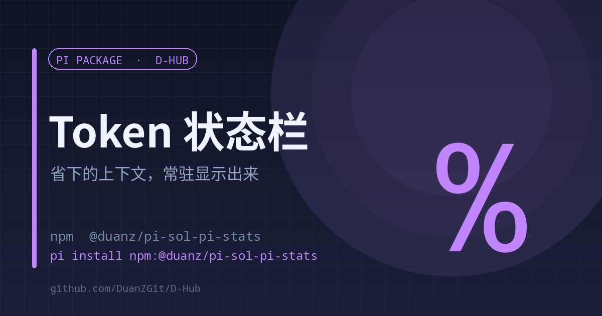

# sol-pi-stats

<p align="center"><a href="./README.en.md">English</a> | <strong>中文</strong></p>

<p align="center"></p>

<p align="center"><strong>observation-pack 省下的上下文，常驻显示在状态栏</strong><br><sub>事件驱动 · 不设定时器 · 异常静默</sub></p>

<p align="center">
<a href="https://www.npmjs.com/package/@duanz/pi-sol-pi-stats"></a>
<a href="https://github.com/DuanZGit/D-Hub/blob/master/LICENSE"></a>
<a href="https://github.com/DuanZGit/D-Hub"></a>

</p>

<p align="center">
<code>pi install npm:@duanz/pi-sol-pi-stats</code>
</p>

## 它解决什么

sol-pi 的 observation-pack 会把大块工具输出折成占位符，省下大量上下文。但它自己只在「省到东西」时闪 4 秒，之后把状态清掉——省下的量到底累计了多少，事后完全看不到。

这个扩展把 ledger 汇总成一条常驻状态：

```
⚡SoL 省 36M tok · 22 包
```

想看明细就用 `/sol`：包数、累计避免量、金额区间、Top 包。

## 数据源

```
<sessionDir>/sol-pi/<sessionId>/observation-pack/ledger.jsonl
```

`event=placeholder` 的行里 `removedTokens` 是该次请求少发的 token（同一个包每次请求各记一条）。

## 实现要点

- **事件驱动，不设定时器**：跟着会话事件刷新，避免空转
- **只在同步阶段读缓存**：不 `await`，防止会话重载后 `ctx` 失效
- **（size, mtime）缓存**：ledger 没变就不重新解析
- **异常静默**：统计失败不影响会话

## 用法

装完即生效。状态栏常驻；`/sol` 看明细。

## 限制

- 需要 sol-pi / observation-pack 真的在产生 `ledger.jsonl`，否则状态栏不会出现数字。
- 金额是区间估算（按输入价与缓存价推算），不是账单。

## License

MIT © DuanZ
