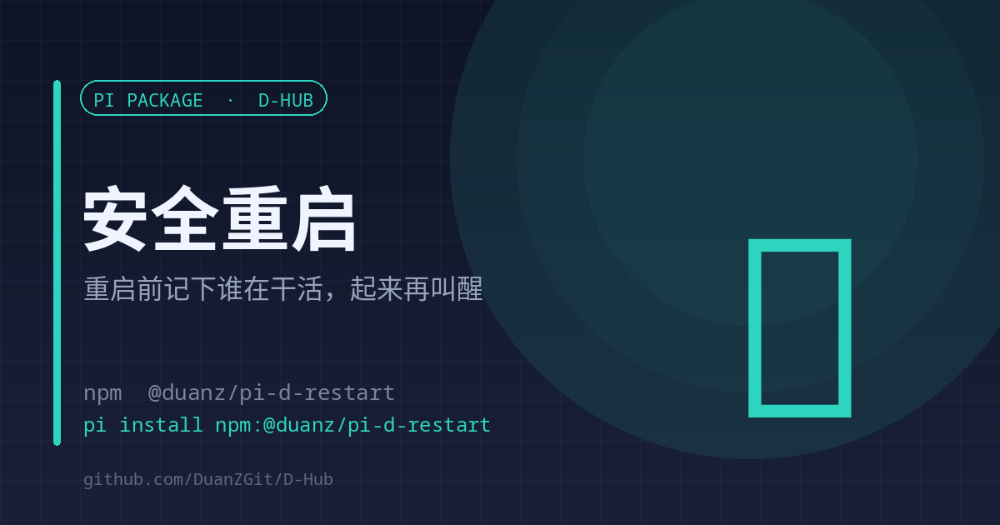

# d-restart

<p align="center"><strong>English</strong> | <a href="./README.md">中文</a></p>

<p align="center"></p>

<p align="center"><strong>Note who is working, restart, then wake every session back up</strong><br><sub>Busy-session snapshot · automatic handoff after readiness · interrupted tool calls repaired</sub></p>

<p align="center">
<a href="https://www.npmjs.com/package/@duanz/pi-d-restart"></a>
<a href="https://github.com/DuanZGit/D-Hub/blob/master/LICENSE"></a>
<a href="https://github.com/DuanZGit/D-Hub"></a>

</p>

<p align="center">
<code>pi install npm:@duanz/pi-d-restart</code>
</p>

## Why

A plain `systemctl restart pi-web` kills every running session — the conversation stops mid-turn, tool calls dangle, and afterwards the model has to guess where it was.

d-restart turns that into a lossless handoff: **snapshot before, resume after**.

## What it does

1. Lists sessions currently running a task through pi-web's local API (`/api/agent/running`)
2. Writes the list into a snapshot file
3. Waits a few seconds so the reply that triggered the restart lands on disk
4. Restarts the service
5. Polls the port until it is actually up
6. Sends each session a "continue" instruction so it keeps going
7. Repairs interrupted `toolCall`s (adds an `isError` `toolResult`) so replay does not 400

The supervisor is dispatched with `systemd-run --user` into its own unit; otherwise restarting pi-web would kill it too.

## Usage

Three triggers, same effect:

| Way | How |
| --- | --- |
| Agent tool | The model calls `d_restart` |
| Slash command | `/d-restart` (alias `/restart`) |
| CLI | `d-restart`, or `node <package>/scripts/d-restart.mjs` |

CLI flags:

```bash
d-restart.mjs --delay 3 --caller <sessionId>
d-restart.mjs --dry-run        # list busy sessions without restarting
```

## Configuration

| Variable | Default | Description |
| --- | --- | --- |
| `PI_WEB_PORT` | auto | Probes `~/.pi/agent/pi-web-run/*.json`, falls back to `30142` |
| `PI_WEB_SERVICE` | `pi-web.service` | systemd user unit |
| `PI_WEB_RESTART_CMD` | empty | Custom restart command, takes precedence over systemctl |
| `PI_SAFE_RESTART_STATE` | `~/.pi/agent/state/piweb-restarting-sessions.json` | Snapshot file |
| `PI_SAFE_RESTART_LOG` | `/tmp/piweb-safe-restart.log` | Log file |

Non-systemd environments (docker / pm2):

```bash
export PI_WEB_RESTART_CMD="docker restart pi-web"
export PI_WEB_PORT=30142
```

## Limits

- **Linux + systemd user** is the default path. macOS has no systemd and falls back to `PI_WEB_RESTART_CMD`, where the supervisor is an ordinary detached process — if the restart command takes the whole process tree down, it dies too.
- Depends on pi-web's `/api/agent/running` and `/api/agent/:id`; nothing to do in pure CLI.
- The snapshot stores session IDs and file paths only — content already lives in the session files.

## Troubleshooting

```bash
tail -f /tmp/piweb-safe-restart.log
```

Common failures:

- `scanned 0 busy sessions` — wrong port, or sessions ended before the restart
- `timed out after 60s waiting for pi-web` — service did not come up; check `systemctl --user status pi-web`
- `resume session ... failed` — session file removed or ID mismatch

## License

MIT © DuanZ
