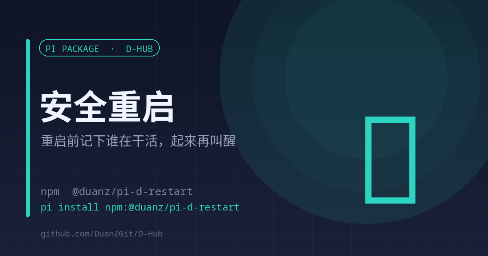

# d-restart

<p align="center"><a href="./README.en.md">English</a> | <strong>中文</strong></p>

<p align="center"></p>

<p align="center"><strong>重启前先记下谁在干活，重启完再把它们叫醒</strong><br><sub>忙碌会话快照 · 就绪后自动接力 · 补回被打断的工具调用</sub></p>

<p align="center">
<a href="https://www.npmjs.com/package/@duanz/pi-d-restart"></a>
<a href="https://github.com/DuanZGit/D-Hub/blob/master/LICENSE"></a>
<a href="https://github.com/DuanZGit/D-Hub"></a>

</p>

<p align="center">
<code>pi install npm:@duanz/pi-d-restart</code>
</p>

## 它解决什么

直接 `systemctl restart pi-web` 会掐断所有正在跑的会话——对话断在半路，工具调用悬空，回来还得自己解释「刚才做到哪了」。

d-restart 把这件事变成一次无损交接：**重启前快照，重启后接力。**

## 它做了什么

1. 调 pi-web 本地 API 列出所有正在跑任务的会话（`/api/agent/running`）
2. 把会话清单写进快照文件
3. 等几秒，让触发重启的那个回复先落到磁盘
4. 重启服务
5. 轮询端口直到服务真的起来
6. 给每个会话发一条「继续」指令，让它自己往下跑
7. 补回被打断的 `toolCall`（补一条 `isError` 的 `toolResult`），避免重放时模型报 400

守护进程用 `systemd-run --user` 派发到独立 unit，否则重启 pi-web 会把它自己一起掐死。

## 用法

三种触发方式，效果一样：

| 方式 | 用法 |
| --- | --- |
| Agent 工具 | 模型自己调 `d_restart`（改完插件让它重启时） |
| 斜杠命令 | `/d-restart`（简写 `/restart`） |
| 命令行 | `d-restart`，或 `node <包目录>/scripts/d-restart.mjs` |

命令行参数：

```bash
d-restart.mjs --delay 3 --caller <sessionId>
d-restart.mjs --dry-run        # 只看当前有几个忙碌会话，不重启
```

## 配置

| 变量 | 默认 | 说明 |
| --- | --- | --- |
| `PI_WEB_PORT` | 自动探测 | 探测 `~/.pi/agent/pi-web-run/*.json`，失败退回 `30142` |
| `PI_WEB_SERVICE` | `pi-web.service` | systemd user unit 名 |
| `PI_WEB_RESTART_CMD` | 空 | 自定义重启命令，设置后优先于 systemctl |
| `PI_SAFE_RESTART_STATE` | `~/.pi/agent/state/piweb-restarting-sessions.json` | 快照文件 |
| `PI_SAFE_RESTART_LOG` | `/tmp/piweb-safe-restart.log` | 日志 |

非 systemd 环境（docker / pm2）：

```bash
export PI_WEB_RESTART_CMD="docker restart pi-web"
export PI_WEB_PORT=30142
```

## 限制

- **Linux + systemd user** 是默认路径。macOS 没有 systemd，靠 `PI_WEB_RESTART_CMD` 兜底，但守护进程只能是普通 detached 进程，重启命令若把整个进程树带走就失效。
- 依赖 pi-web 的 `/api/agent/running` 与 `/api/agent/:id` 接口，纯 CLI 模式用不上。
- 快照只存会话 ID 和 session 文件路径，不存对话内容——内容本来就在 session 文件里。

## 排障

```bash
tail -f /tmp/piweb-safe-restart.log
```

常见失败：

- `共扫描到 0 个正在忙碌的会话` —— 端口探错了，或会话在重启前就结束了
- `超时 60s 未能探测到 pi-web 恢复就绪` —— 服务没起来，先手动 `systemctl --user status pi-web`
- `恢复会话 ... 失败` —— 会话文件被删了或 ID 对不上

## License

MIT © DuanZ
